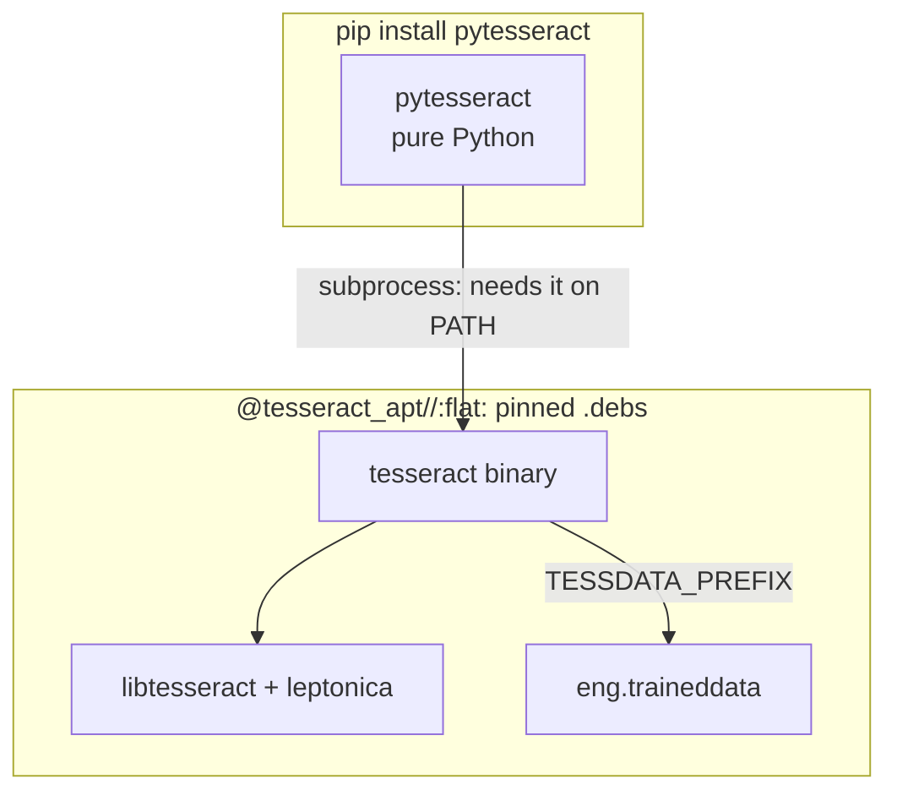
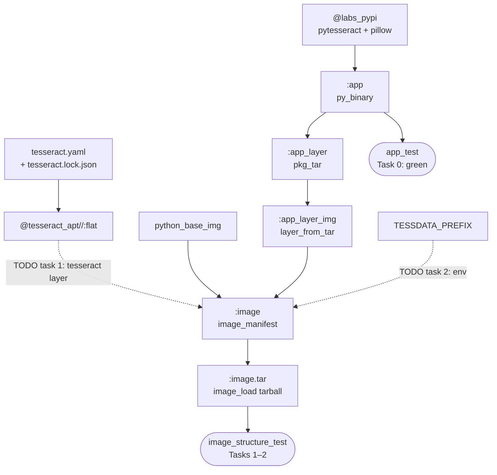

# Level 2 — The "Ghost" Runtime Trap (`pytesseract`)

**Goal:** `pip install pytesseract` gives you a pure-Python wrapper that shells
out to a `tesseract` binary pip never installs. That binary is the ghost. Make
it real by adding a **pinned apt layer** (no `RUN apt-get`, no daemon, no
network), then prove it with a daemonless structure test.



**Deck concepts:** system deps become pinned bytes (`apt.install` +
`layer_from_tar`) · `env` is an attribute, not a step · daemonless validation
(`container_structure_test`, `driver = "tar"`) · *when the image won't run*
(`mergedusr`).



## Start

```bash
bazel test //labs/level2_ghost:image_structure_test   # starts RED (3 checks)
bazel run  //labs:explain -- level2                   # decodes the bare "FAIL"
```

You only edit [`BUILD.bazel`](BUILD.bazel). Look for the `# TODO`s. The checks
live in [`image_test.yaml`](image_test.yaml); the packages are listed in
[`tesseract.yaml`](tesseract.yaml).

> [!TIP]
> No install? Edit in a fork and let GitHub check it: see
> [Check your answers on GitHub](../README.md#check-your-answers-on-github-nothing-to-install).

## Tasks

| # | Run | Starts | Done when |
|---|---|---|---|
| 0 | `bazel test //labs/level2_ghost:app_test` | 🟢 | read it: with an empty `PATH` the engine call fails, which proves the ghost in pure Python |
| 1 | `bazel test //labs/level2_ghost:image_structure_test` | 🔴 | `/usr/bin/tesseract` + `eng.traineddata` are in the image |
| 2 | *same test* | 🔴 | `TESSDATA_PREFIX` in the image config names the data directory |
| ★ | `docker run --rm bwb/level2-ghost --ocr /app/sample.png` | – | OCR runs from the pinned layer (needs Docker) |
| ★ | *same test* | – | the tesseract layer is compressed (Stretch C) |

### Task 1 — bundle the engine as a layer

The hermetic apt tar already exists: `@tesseract_apt//:flat`, pinned by
[`tesseract.lock.json`](tesseract.lock.json). Wrap it as a layer and add it to
the image.

<details><summary>Answer</summary>

```python
layer_from_tar(
    name = "tesseract_layer_img",
    src = "@tesseract_apt//:flat",  # the `tesseract` binary + libs + eng data
)

image_manifest(
    name = "image",
    ...
    layers = [
        ":app_layer_img",
        ":tesseract_layer_img",
    ],
)
```
</details>

### Task 2 — make the data path explicit

Today the engine finds its data without help: Debian compiled
`/usr/share/tesseract-ocr/5/tessdata` into libtesseract as the default. That
default is invisible (it lives inside a binary) and it moves with the build:
Debian's tesseract 4 looked in `.../4.00/tessdata`, a source build looks in
`/usr/local/share/tessdata`. Re-pin to one of those and OCR fails at run time
with `Error opening data file`, while every build-time check stays green.

Write the path into the image config instead. The structure test then checks the
variable *and* the file it points to, so a re-pin that moves the data goes red
at build time.

<details><summary>Answer</summary>

```python
image_manifest(
    ...
    env = {"TESSDATA_PREFIX": "/usr/share/tesseract-ocr/5/tessdata/"},
)
```
</details>

### ★ Stretch A — make OCR actually run

`sample.png` sits in this directory but never reaches the image. Add it to
`pkg_tar(name = "app_layer")`'s `srcs` (it lands at `/app/sample.png`), then:

```bash
bazel run //labs/level2_ghost:image_load
docker run --rm bwb/level2-ghost --ocr /app/sample.png     # -> HERMETIC OCR
```

The binary, `libtesseract`, leptonica, the English `.traineddata` and
`TESSDATA_PREFIX` all came from the pinned layer. Nothing was installed at
runtime and no network was touched. For a harder version, write a *daemonless*
`py_test` that puts the bundled `tesseract` on `PATH` via runfiles.

### ★ Stretch B — the test that passes on a broken image

With Tasks 1–2 done, open [`MODULE.bazel`](../../MODULE.bazel) (region
`mergedusr`), set `mergedusr = False` on `tesseract_apt`, then rebuild, test and
run:

```console
$ bazel test //labs/level2_ghost:image_structure_test
PASSED
$ bazel run //labs/level2_ghost:image_load && docker run --rm bwb/level2-ghost
exec /app/app: no such file or directory
```

The `.deb`s ship real files under `/lib`, but the base image has `/lib` as a
*symlink* into `/usr`. A layer that puts a real directory over a symlink
*replaces* it rather than merging, which removes the base's libraries. The
structure test only `lstat`s paths and never executes anything, so it can't
notice. Revert when done.

### ★ Stretch C — shrink the layer

`layer_from_tar` ships a tar exactly as it gets it, and `@tesseract_apt//:flat` is a plain,
uncompressed tar. The app layer already asks `rules_img` to rewrite it.
Do the same for the system layer:

```python
layer_from_tar(
    name = "tesseract_layer_img",
    src = "@tesseract_apt//:flat",
    optimize = True,  # identical files -> hardlinks, then zstd (see .bazelrc)
)
```

```bash
bazel build //labs/level2_ghost:image
grep -o '"size":[0-9]*' bazel-bin/labs/level2_ghost/image_manifest.json   # the last one is your layer
```

The layer goes from about **130 MB to 58 MB**. Its digest changes, but the files
inside it don't, so the structure test stays green. Docker unpacks zstd layers
from version 23 onwards.

## Stuck?

```bash
bazel run //labs:explain -- level2
diff labs/level2_ghost/BUILD.bazel labs/level2_ghost/solution/BUILD.bazel
```

Re-pin the layer after editing `tesseract.yaml`: `bazel run @tesseract_apt//:lock`.

## Read more

- [`rules_distroless` apt extension](https://github.com/GoogleContainerTools/rules_distroless)
  · [`snapshot.debian.org`](https://snapshot.debian.org/) · [Debian usr-merge](https://wiki.debian.org/UsrMerge)
- [`container_structure_test` test types](https://github.com/GoogleContainerTools/container-structure-test#file-existence-tests)
- [tesseract](https://tesseract-ocr.github.io/tessdoc/) · [pytesseract on PyPI](https://pypi.org/project/pytesseract/).
  The PyPI page tells you to install the engine separately. That sentence *is*
  this level.
