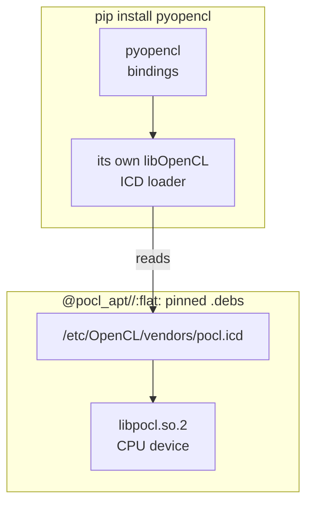
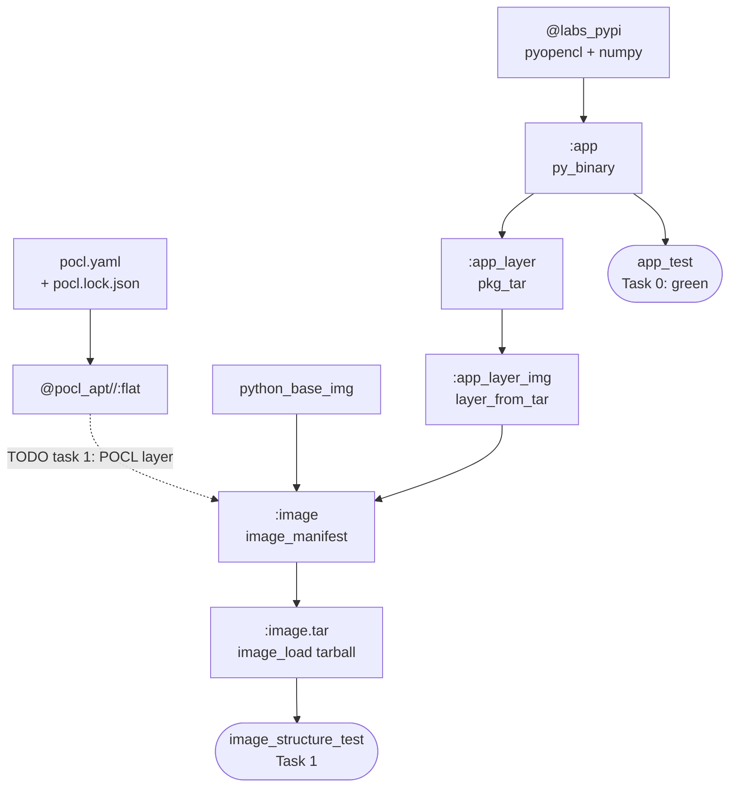

# Level 3 — The Hardware Wall (`pyopencl` + POCL)

**Goal:** `pip install pyopencl` gives you bindings and even an OpenCL loader,
but no *device*: the loader looks for a driver (an *ICD*) and finds none. Bundle
**POCL**, a CPU OpenCL implementation, as a hermetic layer so the image runs a
kernel anywhere.



**Deck concepts:** system deps become pinned bytes (same pattern as Level 2) ·
daemonless validation · a device is a runtime dependency, not just a library.



## Start

```bash
bazel test //labs/level3_hardware:image_structure_test   # starts RED
bazel run  //labs:explain -- level3
```

You only edit [`BUILD.bazel`](BUILD.bazel). Look for the `# TODO`s. The checks
are in [`image_test.yaml`](image_test.yaml); the packages are listed in
[`pocl.yaml`](pocl.yaml).

> [!TIP]
> No install? Edit in a fork and let GitHub check it: see
> [Check your answers on GitHub](../README.md#check-your-answers-on-github-nothing-to-install).

## Tasks

| # | Run | Starts | Done when |
|---|---|---|---|
| 0 | `bazel test //labs/level3_hardware:app_test` | 🟢 | read it: the bindings and device probe work; whether a device *exists* depends on the environment |
| 1 | `bazel test //labs/level3_hardware:image_structure_test` | 🔴 | `/etc/OpenCL/vendors/pocl.icd` + `libpocl.so.2` are in the image |
| ★ | `docker run --rm bwb/level3-hardware` | – | `vector_add` runs on the CPU (needs Docker) |
| ★ | *same test* | – | the POCL layer is compressed (shrink the layer) |

### Task 1 — give the image a device

The CPU OpenCL stack already exists as `@pocl_apt//:flat`. Do the same two edits
as Level 2.

<details><summary>Answer</summary>

```python
layer_from_tar(
    name = "pocl_layer_img",
    src = "@pocl_apt//:flat",  # POCL CPU device + its /etc/OpenCL/vendors entry
)

image_manifest(
    name = "image",
    ...
    layers = [
        ":app_layer_img",
        ":pocl_layer_img",
    ],
)
```
</details>

### ★ Stretch — run a kernel

```bash
bazel run //labs/level3_hardware:image_load
docker run --rm bwb/level3-hardware        # -> vector_add on OpenCL OK: [11.0, 22.0, 33.0]
```

It needs nothing from the host, so it works on any machine. That's why this lab
uses POCL: a CPU device fits in a layer. A real GPU doesn't, because its device
and kernel driver belong to the host and only exist at run time.

### ★ Stretch — shrink the layer

`layer_from_tar` ships a tar exactly as it gets it, and `@pocl_apt//:flat` is a plain,
uncompressed tar. The app layer already asks `rules_img` to rewrite it.
Do the same for the system layer:

```python
layer_from_tar(
    name = "pocl_layer_img",
    src = "@pocl_apt//:flat",
    optimize = True,  # identical files -> hardlinks, then zstd (see .bazelrc)
)
```

```bash
bazel build //labs/level3_hardware:image
grep -o '"size":[0-9]*' bazel-bin/labs/level3_hardware/image_manifest.json   # the last one is your layer
```

The layer goes from about **590 MB to 180 MB**. Its digest changes, but the files
inside it don't, so the structure test stays green. Docker unpacks zstd layers
from version 23 onwards.

## Stuck?

```bash
bazel run //labs:explain -- level3
diff labs/level3_hardware/BUILD.bazel labs/level3_hardware/solution/BUILD.bazel
```

Re-pin after editing `pocl.yaml`: `bazel run @pocl_apt//:lock`. The loader's
path depends on the CPU (`x86_64-linux-gnu` or `aarch64-linux-gnu`), so the test
adds [`image_test_x86_64.yaml`](image_test_x86_64.yaml) or
[`image_test_aarch64.yaml`](image_test_aarch64.yaml) to match the image.

## Read more

- [POCL](https://github.com/pocl/pocl) · [pyopencl docs](https://documen.tician.de/pyopencl/)
- [`rules_distroless` apt extension](https://github.com/GoogleContainerTools/rules_distroless)
  · [Debian usr-merge](https://wiki.debian.org/UsrMerge)
