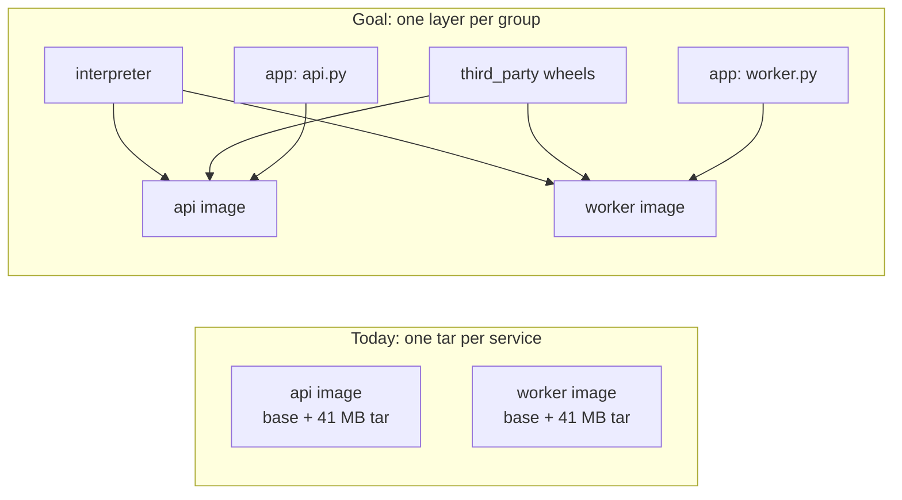
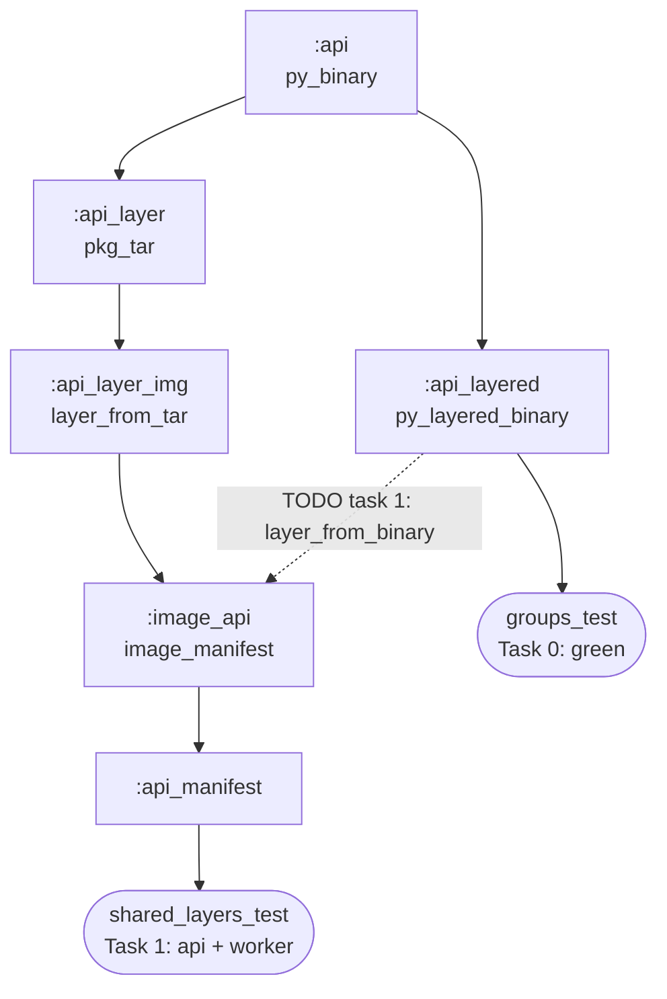

# Level 4 (extra) — One interpreter, N images

**Goal:** ship two Python services, an `api` and a `worker`, so that their images
share the interpreter and the pip wheel. Only the app code should differ. The
deck's recipe, `pkg_tar(include_runfiles = True)`, packs everything into **one
tar**. That's simple, but two services built that way share nothing above the
base. Here you split the binary into layers by **volatility** instead.



**Deck concepts:** split layers by volatility (catering) · content addressing:
same bytes, same digest · shared layers dedupe · the cost of "one tar → one
layer". Do Level 1 first. This lab assumes you know `pkg_tar` → `layer_from_tar`.



`:worker` → … → `:image_worker` has the same shape.

## Start

```bash
bazel test //labs/level4_shared:shared_layers_test   # starts RED
```

You only edit [`BUILD.bazel`](BUILD.bazel). Look for the `# TODO`. The splitting
rule is already written for you in [`defs.bzl`](defs.bzl), and reading it is
part of the lab.

> [!TIP]
> No install? Edit in a fork and let GitHub check it: see
> [Check your answers on GitHub](../README.md#check-your-answers-on-github-nothing-to-install).

## Tasks

| # | Run | Starts | Done when |
|---|---|---|---|
| 0 | `bazel test //labs/level4_shared:groups_test` | 🟢 | read it: the three groups add up to exactly the binary's runfiles |
| 1 | `bazel test //labs/level4_shared:shared_layers_test` | 🔴 | each image adds only its own app layer (< 1 MB) to the other |
| ★ | `bazel run //labs/level4_shared:api_load && docker run --rm bwb/level4-api` | – | both services run from the shared layers (needs Docker) |

### Task 0 — three groups instead of one

[`defs.bzl`](defs.bzl) wraps each `py_binary` in a `py_layered_binary`. That rule
sorts the runfiles into three groups, using the
[rules_runfiles_group](https://github.com/bazel-contrib/rules_runfiles_group) protocol:

| group | holds | changes |
|---|---|---|
| `interpreter` | python-build-standalone, from the Python toolchain | when you bump Python |
| `third_party` | every file from another repo: the pip wheels | when you re-lock |
| `app` | `api.py` / `worker.py` and the launcher | every commit |

`groups_test` checks that the groups add up to exactly the binary's runfiles,
with nothing lost and nothing added. That's also why both binaries set
`legacy_create_init = 0`: Bazel's generated empty `__init__.py` files aren't
real files, so no group can hold them, and Python 3 doesn't need them.

### Task 1 — one layer per group

`shared_layers_test` reads the two image manifests, without a daemon. It wants
exactly one small layer per image that the other lacks (its app code), and
starts red with the bytes the worker adds on top of the api:

```
The worker image adds 41.0 MB on top of the api image, in 1 layer(s):
  sha256:…    41.0 MB
```

That 41 MB is the same interpreter and the same `cryptography` wheel, packed
into a different tar only because the `.py` next to them differs. Replace each
service's `pkg_tar` + `layer_from_tar` pair with rules_img's `layer_from_binary`,
which reads the groups and builds one layer per group.

<details><summary>Answer</summary>

```python
load("@rules_img//img:layer.bzl", "layer_from_binary")  # instead of layer_from_tar

layer_from_binary(
    name = "api_layers",
    binary = ":api_layered",
    path = "/app/api",
)

layer_from_binary(
    name = "worker_layers",
    binary = ":worker_layered",
    path = "/app/worker",
)

image_manifest(
    name = "image_api",
    ...
    layers = [":api_layers"],
)

image_manifest(
    name = "image_worker",
    ...
    layers = [":worker_layers"],
)
```

Delete the two `pkg_tar` and the two `layer_from_tar` rules. The `pkg_tar` load
can go too.
</details>

Then compare the two manifests yourself:

```bash
bazel build //labs/level4_shared:image_api //labs/level4_shared:image_worker
diff <(grep -o 'sha256:[0-9a-f]*' bazel-bin/labs/level4_shared/image_api_manifest.json) \
     <(grep -o 'sha256:[0-9a-f]*' bazel-bin/labs/level4_shared/image_worker_manifest.json)
```

Only two lines differ: the image config and the app layer. The four base layers,
the ~36 MB interpreter and the ~5 MB wheel layer are byte-identical, so a
registry stores them, a cache keeps them and a push sends them **once** for
both services. A third service on the same stack would cost a few KB.

### ★ Stretch — run both, and look inside

```bash
bazel run //labs/level4_shared:api_load && docker run --rm bwb/level4-api
bazel run //labs/level4_shared:worker_load && docker run --rm bwb/level4-worker
docker run --rm --entrypoint ls bwb/level4-api -la /app/api.runfiles
```

The runfiles now live in `/app/.shared_runfiles/`, and `/app/api.runfiles/`
holds one symlink per repo. Both images unpack the shared layers to the same
paths, which is what keeps them byte-identical.

Ask yourself why the deck still teaches the single tar: it's one rule you can
read, and for one service it's the same bytes. The split pays off once you ship
the same stack N times.

## Stuck?

```bash
bazel run //labs:explain -- level4
diff labs/level4_shared/BUILD.bazel labs/level4_shared/solution/BUILD.bazel
```

## Read more

- `rules_img`: [`layer_from_binary`](https://github.com/bazel-contrib/rules_img/blob/main/docs/layer.md)
  · [`image_manifest`](https://github.com/bazel-contrib/rules_img/blob/main/docs/image.md)
- [rules_runfiles_group](https://github.com/bazel-contrib/rules_runfiles_group): the
  `RunfilesGroupInfo` protocol, and how a `*_binary` rule can provide it
- [`samples/shared_layers`](../../samples/shared_layers/): the same idea, with a
  hand-made common layer
- [aspect_rules_py](https://github.com/aspect-build/rules_py): its `py_image_layer`
  also splits a binary into interpreter / packages / app tars. This lab builds the
  split from the protocol underneath. Its tar paths include each binary's own
  `.runfiles` folder, so compare how much two services share with each approach.
