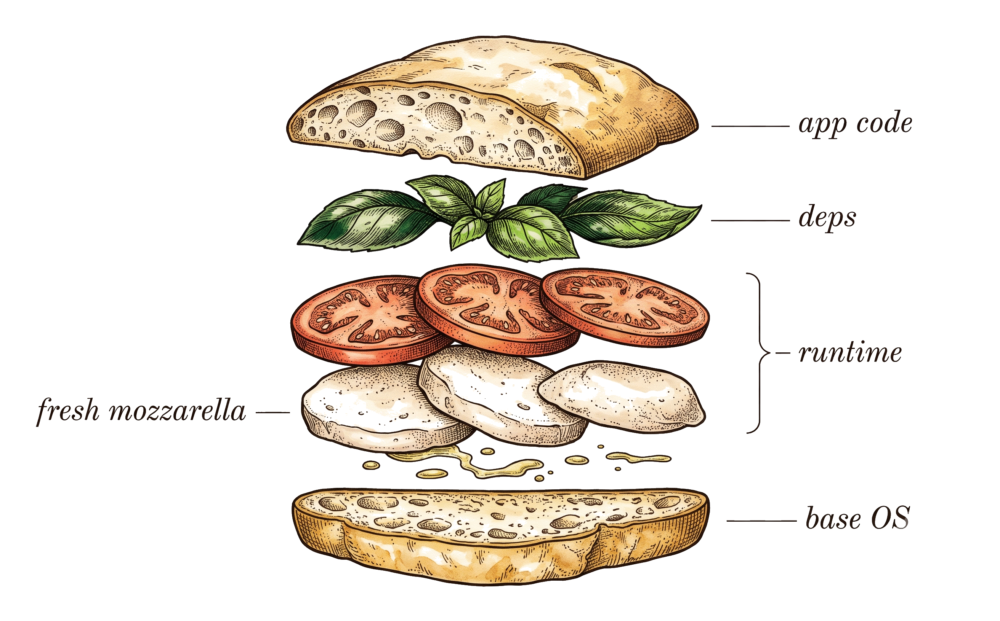
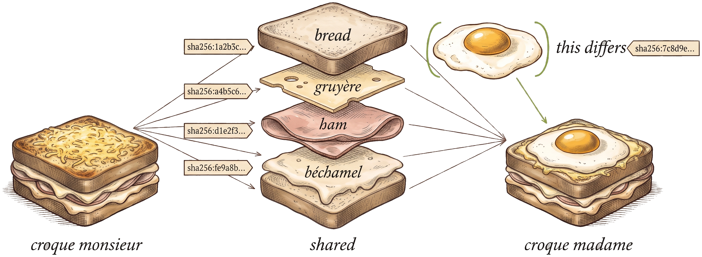
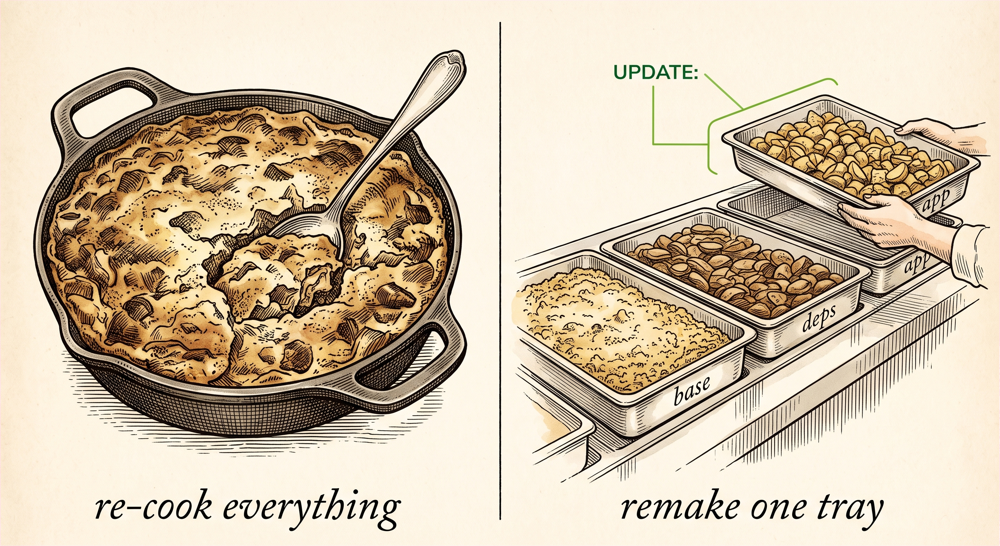
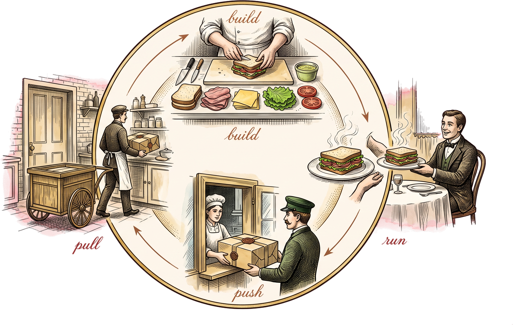
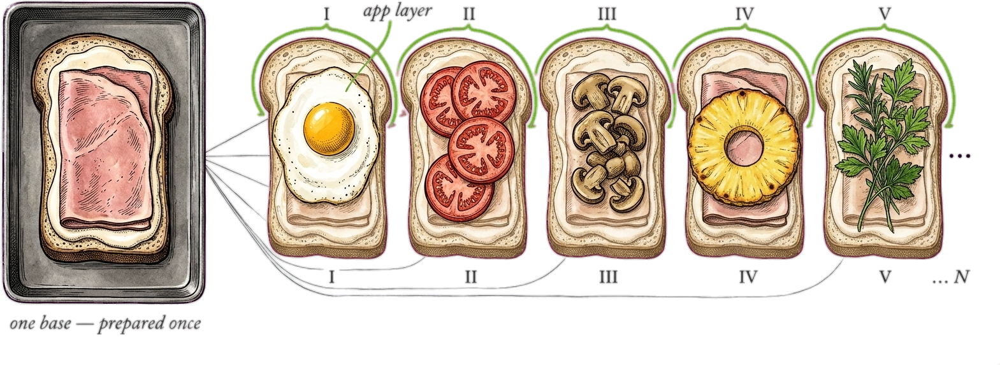
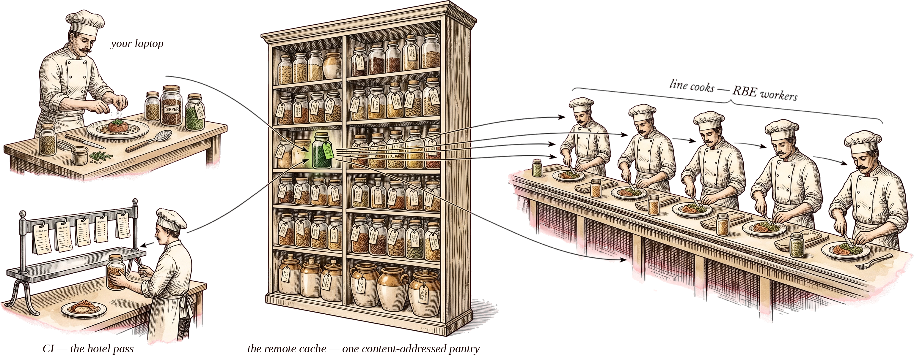

# High-Velocity Image Composition at Scale — Building Images with rules_img

<div class="cover-byline">Rafael Lima, Tweag by Modus Create</div>

---
layout: statement
---

# This slide is a build artifact

`bazel build //slides:build` → this deck.<br>
`bazel build //samples/python:image` → the image we'll discuss.

Same graph. Same cache. Same guarantees.

What you build is byte-for-byte what runs in production —<br>starting with the deck you're watching.

---

# The menu — 90 minutes

| # | Module | We cover | Half | Min |
|---|--------|----------|---|---|
| **0** | **Mise en Place** | what a container image *is* — layers, OCI, CAS | <span class="half-local">local</span> | 14 |
| **1** | **Deterministic image builds** | imperative Dockerfile → declarative `rules_img` | <span class="half-local">local</span> | 18 |
| **2** | **Software catering** | layer split · dedup · distroless | <span class="half-local">local</span> | 17 |
| **3** | **Shipping software** | daemonless push to a registry | <span class="half-ship">delivery</span> | 14 |
| **4** | **Cooking at scale** | remote cache · RBE · one base, N images | <span class="half-ship">delivery</span> | 5 |

<div class="mt-3 opacity-80 text-sm text-center">

Two halves: **0–2 local** — `build` and `run`, on your machine · **3–4
delivery** — `push` and `pull`, out to a registry.<br>
A **Lab** in every module ＋ an **Appendix** for the backup material.

</div>

---

# The lab card

Every command on these slides is a real target in one repo. **Clone it now** —
each module's Lab picks up from the block with its number.

```bash
# 0 · clone, then build the images (skips the Node toolchain the deck needs)
git clone https://github.com/tweag/bazelcon-2026-workshop-docker-build
bazel build //samples/...

# 1 · the rules_img image, then the Dockerfile baseline for contrast
bazel run //samples/python:image_load && docker run --rm bwb/python-graphviz
docker build -t before samples/python && docker run --rm before

# 2 · the hermetic `dot` layer on scratch, and the dedup proof
bazel run //samples/distroless:image_load && docker run --rm bwb/distroless
bazel run //samples/shared_layers:digests

# 3 · push, with zero infra (anonymous registry, 1-hour TTL)
bazel run //samples/python:push_eager

# A · validate the image with no daemon running at all
bazel test //samples/python:image_structure_test
```

<div class="mt-3 opacity-70 text-sm text-center">

<!-- IMAGE: slides/images/repo-qr.png — QR for the repo URL, to sit left of this line -->
Take-home: `bazel run //labs:progress` — build-time · the ghost · hardware.

</div>

---
layout: section
---

# Module 0 · Mise en Place
<div class="opacity-60">What a container image really is · 14 min · Lab: clone + `bazel build //samples/...`</div>
<div class="divider-half half-local">local · build · run</div>

<!-- IMAGE (divider motif, small/corner): slides/images/divider-mise-en-place.png — a tidy mise en place prep station -->


---

# Software: the secret sauce

Software is never *just* the code. Like a béchamel, it's bound to **the pan it's
cooked in** (the build) **and the dish it's served in** (the runtime).

<div class="grid grid-cols-2 gap-6 mt-5">
<div>

### Where it's built
The right pan, the right heat, the exact steps — get any of them wrong and the
sauce won't set the same way twice.

</div>
<div>

### Where it's served
It only shines *inside* a dish. Ship the sauce, and you ship the cookware and the
plating with it.

</div>
</div>

<div class="flex justify-center mt-6">

</div>

---

# The secret sauce, in code

The recipe is pure Python — but it names its own pan. Three ingredients: **app
source**, **pip deps**, and a **system layer** (the `dot` binary) that `pip` will
never install for you.

<<< ../samples/python/app.py#recipe python {*}{maxHeight:'230px'}

<div class="mt-3 opacity-80 text-sm">

That last ingredient — a **system dependency**, shelled out to at runtime — is
the "special pan": hand someone the sauce alone and they still can't cook it.

So don't ship the jar. Ship the **microwavable dish** — sauce, pan and plate
sealed in one tray, everything it takes to *make* it and to *serve* it, reheated
anywhere and coming out the same. That tray is a **container image** — a stack
of **layers**.

</div>

---

# Building an image with a Dockerfile

A `Dockerfile` is a fridge sandwich — whatever's on the shelf, stacked and served.
Tasty maybe, but never reproducible: each `RUN` grabs *today's* ingredients.

<div class="grid grid-cols-[auto_1fr] gap-8 mt-4 items-center">
<div>


</div>
<div>

<<< ../samples/python/Dockerfile#dockerfile docker {4-6}

</div>
</div>

---

# Black-box builds

`RUN apt-get install …` is grabbing a **random tomato** off the shelf: it might
be perfect today, and rotten (or silently *different*) tomorrow.

- **Non-deterministic** — `apt-get` today ≠ `apt-get` tomorrow; a security update
  can change your base out from under you.
- **Coarse cache invalidation** — one early edit busts every layer below.
- **The Docker socket** — a privileged daemon: security surface + CI bottleneck.

<div class="flex justify-center mt-5">

</div>

---

# A sandwich of tars

**Open the tray.** We've been saying *layer* — here's what one actually is. A
container image is a **stack of tar layers** plus a small JSON *image manifest*
& config. That stack — and how everyone agrees to read it — is the **OCI
standard**: the open format every registry and runtime speaks.

<div class="grid grid-cols-2 gap-8 mt-6 items-center">
<div>

- Each **layer** is an ingredient: base, runtime, deps, your code.
- Stacked in order, they make the sandwich; the **image manifest** is the recipe card.
- Your software is just **one** ingredient; the image is the whole sandwich.
- Same ingredients, same order → **the same sandwich, so far**.

</div>
<div>



</div>
</div>

---

# The same layer, only once

That shared start has a name. Each layer ships as a **blob**, and its name is the
`sha256` **digest of its own bytes** — same bytes, same digest, so it's
**stored, moved, and cached once**.

A registry is a **hash table**: the digest is the key, the blob is the value —
**content-addressed storage**, or **CAS**. The **image manifest** is the *ordered*
list of keys — the layers, plus a **config** (env, entrypoint). The **OCI
standard** is every registry and every runtime agreeing on them.

<div class="flex justify-center mt-4">

</div>

---

# Cooking containers with Bazel

Trade the **fridge raid** for a **precise recipe**: declare *what goes where* instead of scripting
steps — Bazel assembles the dish from those inputs, **reproducibly** and at scale.

<div class="grid grid-cols-[auto_1fr] gap-8 mt-2 items-center">
<div>


</div>
<div>

### <span class="verb-glyph"><ph-cooking-pot /></span> Bazel — *build hermeticity*
**Cooking** (the build): only **declared inputs** are visible — identical in, identical out, and it **caches the rest**.

<div class="mt-6">

### <span class="verb-glyph"><ph-shipping-container /></span> Docker — *runtime isolation*
**Plating** (delivery): bundles deps so the artifact runs the same everywhere — self-contained delivery.

</div>

</div>
</div>

<div class="mt-1 text-center text-sm opacity-80">

*Hermetic* is a **build** property. Two different guarantees, and you want **both**: Docker isolates the **plate**; Bazel makes the **kitchen** reproducible.

</div>

---
layout: section
---

# Module 1 · Deterministic image builds
<div class="opacity-60">18 min · Lab: build/run the image vs the Dockerfile</div>
<div class="divider-half half-local">local · build · run</div>

<!-- IMAGE (divider motif, small/corner): slides/images/divider-assembly-line.png — a precise assembly line plating identical dishes -->


---

# The lineage: three generations

This isn't Bazel's first image ruleset — it's the **third**. The workshop picks
up where those tutorials left off.

- **`rules_docker`** — the original; deprecated, drove a daemon.
  <a href="https://www.youtube.com/watch?v=rLDKcNv7xAY" class="text-sm">migration talk ↗</a>
- **`rules_oci`** — the tar-based successor, widely used today.
- **`rules_img`** — the newer, tar-in-CAS, daemonless approach &nbsp;←&nbsp; **today**

<div class="grid grid-cols-2 gap-6 mt-3 px-24">

<a class="talk-card" href="https://www.youtube.com/watch?v=uFxh6rHfMKc" target="_blank">

<div class="talk-cap">Alex Eagle (Aspect) · Bazel Community Day, 2023</div>
</a>

<a class="talk-card" href="https://www.youtube.com/watch?v=biYXmAv4Ppk" target="_blank">

<div class="talk-cap">Malte Poll (Tweag) · BazelCon 2025 · also <code>tweag.io/blog/2025-12-18-rules_img/</code></div>
</a>

</div>

---

# The payload: more than an interpreter

Our app needs more than Python on the shelf — it needs the **`dot` system
binary**. The `graphviz` package is a thin wrapper that *shells out* to it:

<div class="grid grid-cols-2 gap-6 mt-4 code-sm">
<div>

<<< ../samples/python/app.py#render python

</div>
<div>

```console
$ bazel run //samples/python:app -- --render /tmp/supply_chain.png
// Building Without Bytes
digraph supply_chain { … }

[skip] `dot` not found on PATH; printed DOT source only.
Add the graphviz system layer to render a PNG.
```

</div>
</div>

<div class="mt-4 opacity-80 text-sm">

Not a crash — a graceful `[skip]`: the app tells you **which ingredient is
missing**. `pip` is blind to `dot`, so leave the daemon behind and that ghost has
to become an **explicit layer** — the "special pan" we now have to pack.

</div>

---

# Meet `rules_img`

<div class="text-center text-3xl mt-12 mb-10">

**Build time produces metadata. Run time moves bytes.**

</div>

- **No daemon** — no socket, nothing privileged, nothing to keep running.
- **Built for a remote cache and remote execution** — a layer is an ordinary Bazel
  action, so it builds on **RBE** workers and lands in the **shared cache**: built
  once, never rebuilt or re-downloaded anywhere. *(Module 4.)*

---

<div class="step-kicker"><span class="hl-base">FROM</span></div>

# A base is a digest, not a tag

Four directives, one at a time — imperative **steps that run** become declarative
**artifacts that assemble**.

<div class="code-sm">

```docker
FROM python:3.12-slim-bookworm
```

<div class="xlate-arrow leading-none my-1">↓</div>

<<< ../MODULE.bazel#base_pull python {7}

```python
base = image("python_base_img")   # samples/python/BUILD.bazel — the consuming side
```

</div>

<div class="mt-3 text-center text-sm">

It names *bytes*, not a tag, and resolves **once when the module graph loads** —
never again at build time. (`layer_handling = "lazy"` previews Module 4: the
base's blobs are fetched only when something actually needs them.)

</div>

---

<div class="step-kicker"><span class="hl-deps">RUN apt-get</span></div>

# The system dep becomes pinned bytes

<div class="xlate mt-6">
<div>

```docker
RUN apt-get update \
 && apt-get install -y graphviz
```

</div>
<div class="xlate-arrow">→</div>
<div>

<<< ../MODULE.bazel#apt_ext python

<<< ../samples/distroless/BUILD.bazel#apt_layer python

</div>
</div>

<div class="mt-4 text-center">

`dot` ＋ its **162 transitive `.deb`s** resolve against `graphviz.lock.json` in
the *loading* phase and land as **one content-addressed layer** — with **no
network in any build action**.

</div>

<div class="mt-3 text-center text-sm opacity-70">

*"Couldn't I just pin apt in the Dockerfile?" You'd be pinning a **command**;
here you pin **bytes**.*

</div>

---

<div class="step-kicker"><span class="hl-src">RUN pip · COPY</span></div>

# Four steps, one layer

<div class="xlate xlate-top mt-4 code-sm">
<div>

```docker
COPY requirements_lock.txt .
RUN pip install -r requirements_lock.txt
WORKDIR /app
COPY app.py /app/app.py
```

<div class="mt-5 text-sm">

**Same shape as `apt.install`** — one package manager over.

`pip.parse` generates a **hub repo** at *load* time: `@pypi`. So
`requirement("graphviz")` is just `@pypi//graphviz`.

Then `include_runfiles = True` packs everything it resolved to — hermetic 3.12
interpreter ＋ wheel ＋ `app.py` — into **one tar → one layer**.

</div>

</div>
<div class="xlate-arrow">→</div>
<div>

<<< ../MODULE.bazel#pip_hub python

<<< ../samples/python/BUILD.bazel#pip_layer python

</div>
</div>

---

<div class="step-kicker"><span class="hl-entry">ENTRYPOINT</span></div>

# The entrypoint is a launcher

<div class="xlate mt-8">
<div>

```docker
ENTRYPOINT ["python", "/app/app.py",
            "--render", "/tmp/supply_chain.png"]
```

</div>
<div class="xlate-arrow">→</div>
<div>

```python
image_manifest(
    name = "image",
    base = image("python_base_img"),
    entrypoint = [
        "/app/app",              # py_binary bootstrap launcher
        "--render", "/tmp/supply_chain.png",
    ],
    layers = [":app_layer_img"],
)
```

</div>
</div>

<div class="mt-5 text-center">

Look again: **no `python`** — `/app/app` finds `app.runfiles` and execs the
*hermetic* interpreter that shipped in the layer. But `rules_img` didn't *make*
that launcher: `py_binary` did, and `pkg_tar(include_runfiles = True)` shipped
it. `entrypoint` is only a field in the image's **OCI config JSON** — a pointer
at a file already sitting in a layer. Declare, don't run. (`ENV` goes the same
way: `env = {…}`, an attribute, not a step.)

</div>

---

# The whole translation

<div class="xlate-recap mt-6">

| Dockerfile | Bazel | package · what does it |
|---|---|---|
| <span class="hl-base">FROM</span> `python:3.12-slim-bookworm` | <span class="hl-base">base</span> `= image("python_base_img")` | `rules_img` · `images.pull` resolves the tag to a digest at **load** time |
| <span class="hl-deps">RUN apt-get</span> `install graphviz` | <span class="hl-deps">apt.install</span> ＋ <span class="hl-deps">layer_from_tar</span> | `rules_distroless` · `apt.install` makes the `@graphviz_apt` hub from a lockfile |
| <span class="hl-src">RUN pip</span> ＋ <span class="hl-src">WORKDIR</span> ＋ <span class="hl-src">COPY</span> | <span class="hl-src">py_binary</span> → <span class="hl-src">pkg_tar</span> → `layer_from_tar` | `rules_python` · `pip.parse` makes the `@pypi` hub · `rules_pkg` · `pkg_tar` tars the runfiles |
| <span class="hl-entry">ENTRYPOINT</span> `["python", "/app/app.py", …]` | <span class="hl-entry">entrypoint</span> `= ["/app/app", …]` | `rules_img` · `image_manifest` writes it into the OCI **config JSON** |

</div>

<div class="mt-4 text-center text-sm">

And the commands that replace the daemon verbs — every one a **target**, not a
socket call: `bazel build //samples/python:image` (assemble) ·
`bazel run …:image_load` (run) · `bazel run …:push` (ship) ·
`bazel test …:image_structure_test` (validate, `container_structure_test`).

</div>

<div class="mt-3 text-center opacity-80 text-sm">

`image_load` / `image_push` have no Dockerfile counterpart at all — there is no
Dockerfile directive for *"send this to a registry"*.

</div>

---

<div class="step-kicker opacity-55">build</div>

# Assemble, don't run

<div class="grid grid-cols-2 gap-6 mt-4">
<div>

<div class="code-sm">

<<< ../samples/python/BUILD.bazel#image python {*}{maxHeight:'300px'}

</div>

</div>
<div>

```bash
bazel build //samples/python:image
# → image_manifest.json
#   image_config.json
#
# the layer blobs stay in the cache —
# nothing is tarred twice
```

<div class="mt-4 opacity-80 text-sm">

The `py_binary` and the `pkg_tar` are on the two slides you just saw — this is
the last two rules. No daemon; each layer's tar is built and compressed **once**
into the cache, so an edit re-assembles rather than re-tars.

</div>

</div>
</div>

---

<div class="step-kicker opacity-55">run</div>

# Load it like any other image

**Load** into your local daemon, then `docker run` like any other image. (Against
a **containerd** store the Go loader adds only the blobs it lacks; a classic
Docker daemon still takes a full `docker load`.)

```bash
bazel run //samples/python:image_load   # image_load → Docker
docker run --rm bwb/python-graphviz
```

---

# The "Docker tax"

Hermeticity's payoff is **efficiency**. Same suite, two ways — `py_test`
(sandboxed, cached, incremental) vs. a `docker build` that pip-installs and runs
pytest. Change one line, re-run:

```bash
bazel run //benchmark/pytest_tax:compare
#   bazel test  (warm, after edit)    ~0.8 s
#   docker build (warm, after edit)   ~2.2 s   ← per-edit "tax"
#   docker build (cold, --no-cache)  ~11   s   ← upfront "make it hermetic" cost
```

<!-- IMAGE (pending): slides/images/docker-tax.png — a kitchen pass where every plate leaving must have a coin dropped in a tin (the per-edit tax), beside a second pass the same plate walks straight through. The .img-slot placeholder is removed until the art exists. -->

<div class="mt-2 text-sm opacity-80">

Absolute numbers are machine-dependent; the **ratio per edit** is the point —
and it grows with image size and dependency count.

</div>

---
layout: section
---

# Module 2 · Software catering
<div class="opacity-60">17 min · Lab: layer split · dedup · distroless</div>
<div class="divider-half half-local">local · build · run</div>

<!-- IMAGE (divider motif, small/corner): slides/images/divider-catering-trays.png — a row of catering trays, each ingredient prepped separately -->


---

# Catering vs the one-pot bake

Order layers least → most volatile so rebuilds stay cheap:

1. **Base OS** — static &nbsp;·&nbsp; 2. **Runtimes / deps** — infrequent &nbsp;·&nbsp; 3. **App code** — most volatile

Change one string in a multi-GB app:

```bash
$ docker build -t app .              # invalidates at COPY . /app → 2–3 min
$ bazel run //samples/python:image_load # re-assembles one blob → seconds
```

<div class="flex justify-center mt-4">

</div>

<div class="mt-1 opacity-80 text-center text-sm">

One dish, and every edit re-cooks the whole thing — run a **catering line** and you remake only the tray that changed.

</div>

---

# Distroless: a sandwich without the bread

Take the base OS away and keep only the filling. It works because `apt.install`
already resolved `dot` at **load** time into content-addressed layers — no `RUN`
is left that needs an OS underneath it:

<<< ../samples/distroless/BUILD.bazel#distroless python {*}{maxHeight:'200px'}

<div class="mt-2 opacity-80 text-sm">

Read it for what **isn't** there: no `base`, so `platform` has to be spelled out;
no shell, no package manager, no apt database — nothing to exploit but the binary
itself. The `dot` from Module 0, now a **hermetic, pinned** layer on `scratch`.

</div>


---
layout: two-cols-header
layoutClass: gap-6
---

# Two services, one shared blob

An `api` and a `worker` on the same base ＋ a shared config/lib layer; only each
service's own app layer differs.

::left::

<<< ../samples/shared_layers/BUILD.bazel#shared python {*}{maxHeight:'250px'}

::right::

```bash
bazel run \
  //samples/shared_layers:digests
# SHARED (built & pushed once):
#  sha256:…  base layers (×4)
#  sha256:…  common config/lib
# + 1 unique app layer each
```

Any **byte-identical** layer dedupes automatically — prep once, plate twice.

---
layout: two-cols-header
layoutClass: gap-6
---

# When the image won't run

The layers composed, the tests were green — and it still dies on `docker run`.
Two probes, neither of which needs a daemon.

::left::

### The one that fails silently

```console
$ bazel test //labs/level2_ghost:image_structure_test
PASSED
$ docker run --rm bwb/level2-ghost
exec /app/app: no such file or directory
```

<<< ../MODULE.bazel#mergedusr python {*}{maxHeight:'150px'}

::right::

### Look inside without running it

```bash
# 1 · what is actually in this layer?
tar tf bazel-bin/labs/level2_ghost/app_layer.tar

# 2 · why is a rung red? decode the
#     structure test's bare FAIL
bazel run //labs:explain -- level2
```

The structure test `lstat`s paths in an unpacked tar — it never **execs**
anything, so it passes happily on an image that cannot run a single binary.

<div class="mt-3 opacity-70 text-sm text-center">

A green test proves the *files* are there — not that the **loader** can find them.
Outside Bazel it gets stranger still; that's Module 4, and the appendix.

</div>


---
layout: section
---

# Module 3 · Shipping software
<div class="opacity-60">14 min · Lab: push to a local registry</div>
<div class="divider-half half-ship">delivery · push · pull</div>

<!-- IMAGE (divider motif, small/corner): slides/images/divider-delivery.png — a delivery van / dispatch window shipping finished dishes -->


---


# Two halves of the loop

Docker has four verbs. **We've done the local two** — everything so far was
`build` and `run` on your own machine. The other two leave the building.

<div class="grid grid-cols-[auto_auto] gap-10 mt-2 items-center justify-center">
<div>

</div>
<div class="text-sm">
<div class="verb-done"><strong>build</strong><div class="opacity-70">Dockerfile → image</div><div class="verb-tag">Modules 0–2 ✓</div></div>
<div class="verb-done mt-4"><strong>run</strong><div class="opacity-70">image → container</div><div class="verb-tag">Module 1 ✓</div></div>
<div class="verb-now mt-4"><strong>push</strong><div class="opacity-70">image → registry</div><div class="verb-tag">this module</div></div>
<div class="verb-now mt-4"><strong>pull</strong><div class="opacity-70">registry → image</div><div class="verb-tag">Module 4</div></div>
</div>
</div>

<div class="mt-2 opacity-80 text-sm text-center">

**Delivery** is where content addressing stops being trivia and starts being
**bandwidth**: a registry already holding a blob doesn't want it twice.

</div>

---

<div class="step-kicker opacity-55">push</div>

# Push — daemonless, to any registry

A registry is a **central pantry** keyed by content: push once, and every kitchen
pulls the exact same ingredient. `rules_img` → `image_push`: no daemon, no socket
— it talks straight to the registry API.

<div class="mt-4">

**Experiment 1 · zero infra.** `ttl.sh` is an anonymous, write-open registry —
no daemon, no local registry, no login:

```bash
bazel run //samples/python:push_eager   # → ttl.sh/bwb-graphviz:1h (1-hour TTL)
```

Prefer a local registry? Two targets, same result:

```bash
bazel run //tools:local_registry        # registry:2 (or crane) on localhost:5000
bazel run //samples/python:push
```

</div>

---

<div class="step-kicker opacity-55">push</div>

# Optimizing the push

Everything from here is about **not moving bytes you don't have to**:

1. **Only the missing blobs go up.** Module 2's dedup, now spent as
   **bandwidth** — a shared base layer uploads *once*.
   Run `push_eager` a second time:

   ```bash
   bazel run //samples/python:push_eager   # blobs already present → skipped
   ```

2. **`strategy = "eager"`** — every blob rides in the push target's **runfiles**,
   and `bazel run` uploads them. Zero infra, works anywhere. *That's what we just
   ran.*

3. **`strategy = "lazy"`** — the push tool streams blobs **straight from a remote
   cache**, so nothing is staged into runfiles. It needs infra we haven't met yet
   → **Module 4**, and it's demoable in the Appendix.

<div class="mt-3 opacity-70 text-sm">

Rule of thumb: **eager** for laptops and small images · **lazy** once you have a
cache.

</div>

---
layout: section
---

# Module 4 · Cooking at scale
<div class="opacity-60">Remote cache · RBE · one base, N images · ~5 min</div>
<div class="divider-half half-ship">delivery · push · pull</div>

<!-- IMAGE (divider motif, small/corner): slides/images/divider-chain-kitchen.png — a large industrial / restaurant-chain kitchen -->

---

# One base, N images

The dedup proof, at monorepo scale. `//samples/shared_layers` shows two services;
now imagine **N**:

- Base + shared config/lib layer → built, cached, and pushed **once**.
- Each service adds only its **own** app layer.

A 200-service monorepo on a shared base ships ~200 *small* app blobs — not 200×
the base. The `:digests` diff you ran is the same mechanic, just multiplied.

<div class="flex justify-center mt-3">

</div>

<div class="mt-1 opacity-70 text-sm text-center">

**"at scale"** = the shared bytes are paid for **once**, no matter how many images.

</div>

---

# Building Without Bytes

The name of the game: **compose and ship images by moving *references* (digests),
not layer *bytes*.**

- **Bytes stay in CAS** — the layer's tar is built once; only its `sha256`
  descriptor flows through the build graph.
- **Only-missing-blobs move** — push and pull skip anything the other side
  already has.
- **Lazy pulls** — reference a base by digest and materialize its bytes only when
  a step needs them (`layer_handling = "lazy"`, in `MODULE.bazel`).

<div class="flex justify-center mt-2">

</div>

<div class="mt-1 opacity-80 text-center text-sm">

Most of an image's bytes are the base + deps you *didn't* change — so most of the time, you move **none** of them.

</div>

---

# The pantry, chain-wide: cache + RBE

Scale the shared pantry from one kitchen to a **restaurant chain**: one commissary
larder, and every kitchen on the chain draws from it.

<div class="flex justify-center mt-2">

</div>

```bash
bazel build //... --remote_cache=grpcs://cache.corp   # or --remote_executor=…
```

<div class="mt-2 text-sm opacity-80">

**Remote cache** — a blob built once is never rebuilt or re-downloaded anywhere.<br>
Content-addressing is what makes that *safe*: same digest ⇒ same bytes, so nobody rebuilds what someone already built.

</div>

---
layout: center
class: text-center
---

# Takeaways

**Declare, don't script** — a layer is a build output, not a step a daemon runs.<br>
**Split by volatility** — layers build **in parallel**, identical ones **dedupe**, `scratch` ships **thin**.<br>
**Go daemonless** — assemble, validate and push with no socket, nothing privileged.<br>
**Share the pantry** — a **remote cache** ＋ **RBE** rebuilds nothing, and moves only missing blobs.<br>
**Build without bytes** — the tars stay in CAS; only digests travel.<br>
**Slide-as-Code** — the deck is just another build target.

<div class="mt-6 opacity-70">

What you build is byte-for-byte what runs — layers are just build outputs.<br>
Coming from `rules_oci`? Same declarative model; the win is keeping the **bytes**
out of the graph.

</div>

<div class="mt-4 text-sm opacity-70">

Keep going: `bazel run //labs:progress` — the self-paced ladder through the three
walls (build-time · the ghost · hardware).

</div>

---
layout: center
class: text-center
---

# Thanks 🙏

This workshop stands on a lot of shoulders.

**Malte Poll** — `rules_img` itself, and the patience to answer for it.<br>
**Alejandro Gomes** — the original idea.<br>
**Johan Herland · Mark Karpov · Rogerio Fonteles · Xinyu Wang** — reviews that reshaped this deck.<br>
**Jimmy Tanner** — support and discussions about containers.<br>
**Tweag by Modus Create** — for sponsoring the work.<br>
**Ruleset maintainers** — `rules_distroless`, `rules_python`, `rules_pkg`, `container_structure_test`.<br>
**The Bazel team & BazelCon organizers** — the platform and the venue.<br>
**You** — for spending the morning talking about food and containers.

<div class="opacity-70 mt-6">

github.com/tweag/bazelcon-2026-workshop-docker-build

</div>

---
layout: section
---

# Appendix
<div class="opacity-60">If time / backup · two Dockerfile habits · validating without a daemon · looking at an image outside Bazel · two comparison tables</div>

<!-- IMAGE (divider motif, small/corner): slides/images/divider-tasting-spoon.png — a chef tasting from a spoon (quality check) -->

---

# Why there's no `RUN` to run

We already replaced `RUN apt-get` with `apt.install` + `layer_from_tar`. Here's
*why* it had to move — and it isn't stylistic:

<div class="grid grid-cols-2 gap-8 mt-5">
<div>

### Build actions have no network
Bazel sandboxes every action. There is no `RUN` to run, because nothing may
reach out mid-build. Deps resolve in the **loading** phase instead, and a
**lockfile** pins exactly which bytes.

</div>
<div>

### So the packages become artifacts
`dot` + its `.deb` packages land as ordinary **content-addressed layers** — same
inputs, same digest. Which is the only reason Module 2 worked at all: byte-identical
layers **dedupe**, and an image with no base at all becomes possible.

</div>
</div>

<div class="mt-5 opacity-80 text-center">

That's the whole trade: give up *running commands* at build time, get
**reproducible bytes** you can cache, dedupe, and ship.

</div>

---

# `docker run` as a test?

A test is a **self-verifying requirement** — the dish that checks its own
seasoning (Toyota's *autonomation*: build quality in, don't inspect it in later).

<div class="grid grid-cols-2 gap-6 mt-5">
<div>

### The tempting shortcut
`docker build` a full image, `docker run` it, assert on the output. It works…

</div>
<div>

### The hidden cost
…but you cooked the **whole dish** just to taste one bite. Slow, daemon-bound,
serialized — a tax on every single check.

</div>
</div>

<div class="mt-5 text-center opacity-80">

We want the taste test **without** cooking the whole tray every time.

</div>

---

# Daemonless validation

Two cheaper tastes, before you ever start a container:

- **Test the entry script directly** — `py_test` runs the payload sandboxed,
  cached, and in parallel; no image needed.
- **A quick negative test** — `docker run --network=none …` surfaces undeclared
  host deps. Handy, but not a proof; the **sandbox** is.

<div class="mt-6 opacity-80">

The rigorous validator is Bazel's sandbox: only *declared* inputs are visible, so
a missing ingredient fails at build time — every time.

</div>

---

<div class="step-kicker opacity-55">test</div>

# Test: `container_structure_test`

**Validate without a daemon.** With `driver = "tar"` it inspects the image's
**files and config in the Bazel sandbox** — no runtime — and fans out in parallel.
(`container_structure_test` — GoogleContainerTools; a community project.)

<<< ../samples/python/image_test.yaml yaml {*}{maxHeight:'190px'}

```python
container_structure_test(name = "image_structure_test",
    image = ":image.tar", configs = ["image_test.yaml"], driver = "tar")
```

---

# Inspecting a layer outside Bazel

Point `skopeo` or `dive` at an image target and they bounce off it. The default
on-disk shape is a ***sparse*** OCI layout — deliberately missing its bytes:

```bash
bazel-bin/samples/python/image_sparse_oci_layout/
  sparse-oci-layout                     # not `oci-layout`
  root.descriptor.json                  # not `index.json`
  blobs/sha256/<digest>.descriptor.json # a stub where the layer should be
```

**Ask for a real one.** `image.oci` is spec-compliant; `image.oci.tar` is the same layout, packed.

<<< ../samples/python/BUILD.bazel#oci_layout python {*}{maxHeight:'205px'}

---

# Or skip the layout entirely

A registry is the other way to read an image without a daemon — and without
materializing a folder full of links first:

```bash
bazel run //tools:local_registry -- --hermetic
bazel run //samples/python:push
bazel run //tools:crane_cli -- \
    manifest localhost:5000/bwb/python-graphviz:latest
bazel run //tools:crane_cli -- \
    export  localhost:5000/… - | tar tf - | grep bin/dot
```

`crane export` flattens every layer into one tar — **8692 paths**, and no
`bin/dot`. The ghost from Module 2, proven without ever starting a container.

Worth skipping: even a real `image.oci` is mostly **symlinks** into the execroot —
`du -sh` reads **60K** where the content is **325M**, so materializing it means
`cp -rL` (or `image.oci.tar`, which has real bytes).

<div class="mt-4 opacity-70 text-sm">

Needs **nothing installed**: both `crane` and the registry are pinned static
binaries, fetched by Bazel. And a layout is a set of dangling links until you ask
for them — under `--remote_download_minimal` the bytes may never come home at
all, taking `image.tar` from **258 MB** to **177 KB**.

</div>

---

# Experiment 2 · lazy push — with a remote cache

Now that we have the cache: **lazy** push (`strategy = "lazy"`) skips the runfiles
and streams blobs **straight from the remote cache** to the registry — the win
when images are huge or numerous.

```bash
bazel run //tools:local_cache                   # a cache on localhost, no account
bazel run --config=local-bwb \
    --@rules_img//img/settings:remote_cache=grpc://localhost:9092 \
    //samples/python:push_lazy
```

- **Needs a remote cache — not remote execution.** `img` speaks REAPI ByteStream
  straight to the CAS. `//tools:local_cache` is a pinned static binary, so you can
  run this in this room.
- **Credential-free:** local cache + local registry means nothing needs auth. With
  a hosted cache, keep pushing to `ttl.sh` so only the *cache* does. A CI-friendly
  *push-at-build-time* variant exists too.

<div class="mt-3 opacity-70 text-sm">

Rule of thumb: **eager** for laptops/small images · **lazy** once you have a cache.

</div>

---

# Same artifact, two philosophies

| Feature | Dockerfile | Bazel + `rules_img` |
|---|---|---|
| **Execution** | Imperative | Declarative |
| **Hermetic build** | No | Yes |
| **Daemon req.** | Yes | No |
| **Layer tar** | Re-tarred per build | Built once, kept in CAS |
| **Layer dedup** | Coarse | Content-addressed |

<div class="text-sm mt-3">

**Measured, not asserted** — every row is exercised by a real target in this repo:
`//samples/shared_layers:digests`, the daemonless push, the `tar`-driver test.
Reproducible digests assume the usual controls (zeroed timestamps, stable ordering,
pinned compression); the *runtime* still depends on the host kernel.

</div>

---

# Coming from `rules_oci`?

The concepts carry straight over — it's the same declarative model. Four things
are genuinely new, and they're all the same idea: **keep the bytes out of the graph.**

<div class="grid grid-cols-2 gap-8 mt-3">
<div>

### Carries over
- Composing layers in a `BUILD` file
- Base images pinned **by digest**
- Daemonless push *(eager push is much like `rules_oci` — not a differentiator)*
- Structure tests

</div>
<div>

### New in `rules_img`
- Layer tars **stay in CAS** — never re-tarred, never staged into runfiles
- `strategy = "lazy"` streams blobs from a remote cache over REAPI ByteStream
- **Shallow pulls** — a base costs a manifest ＋ config, not its layers
- Sparse OCI layouts by default

</div>
</div>

<div class="mt-3 text-xs">

**Renames:** `oci_image`→`image_manifest` · `tars`→`layers` · `workdir`→`working_dir` ·
`oci_load`→`image_load` · `oci_push`→`image_push` (`repository` splits into
`registry`＋`repository`; `remote_tags`→`tag_list`).
**Trade-offs:** `os`/`architecture` follow the Bazel target platform, and
`exposed_ports`/`volumes` move into `config_fragment`.
**Interop runs both ways**, so migration can be incremental rather than a cutover.

</div>
